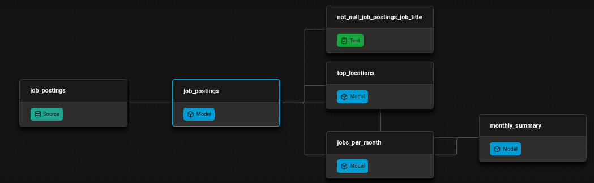

# Automated Job Postings Pipeline (v1) - dbt + DuckDB

A public dbt + DuckDB pipeline over ~692k real job postings, rebuilt and republished automatically on every push.

    - Models the raw postings into tested, documented insight marts
    - Publishes the docs site and the finished warehouse — open to anyone, no credentials
    - Runs itself on GitHub Actions: every push and every Monday

[Live docs site](https://hrapanoel.github.io/dbt-duckdb-pipeline/)
## The dbt pipeline
Raw postings flow through three dbt layers — declared sources → cleaned staging views → insight marts — with tests gating every build. The DAG below is the whole flow:

